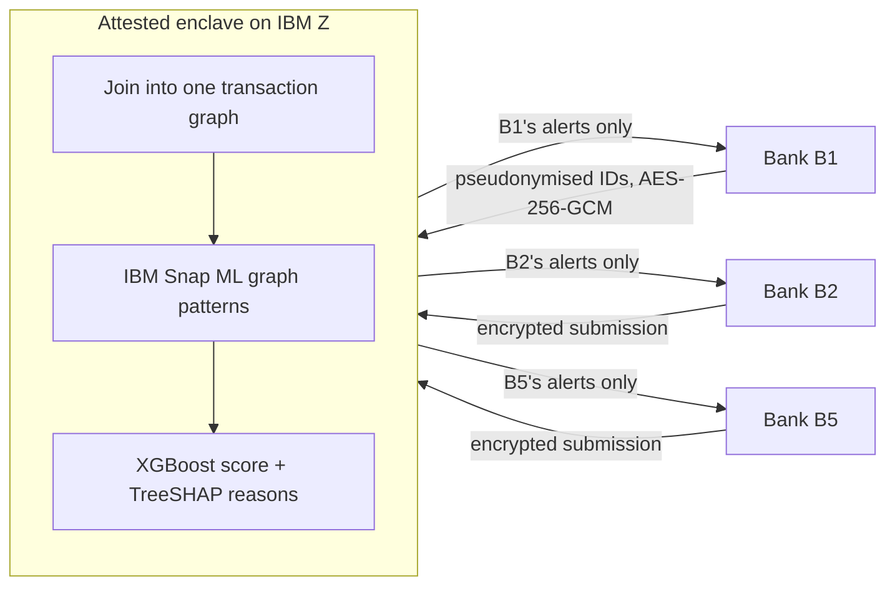
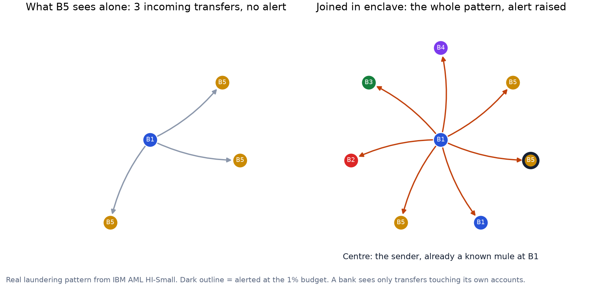

# MuleNet-Z

**Banks catch a third more money-mule accounts by joining their data inside an IBM Z enclave, where no bank sees another bank's customers.**

IBM Z Datathon 2026 · Theme: *AI Secured: Innovation Without Exposure* · Team: Arindam Gogoi, Niyati Joshi, Vishwajeet Sonawane, Vipul Gujar

| | |
|---|---|
| Demo video | [add YouTube link] |
| Pitch deck (PDF) | [docs/MuleNet-Z_deck.pdf](docs/MuleNet-Z_deck.pdf) |
| Live bank console | [leo-leo-691.github.io/mulenet-z/demo](https://leo-leo-691.github.io/mulenet-z/demo/) |

## Results at a glance

On IBM's AML dataset (5,078,345 transactions, 515,088 accounts, 5 banks), each bank alerting on its top 1% of accounts:

| | Each bank alone | Joined in the enclave |
|---|---|---|
| Mule accounts caught (recall) | 19.0% | **25.0%** (+6.0 pts, 95% CI +3.9 to +8.0) |
| Cross-bank laundering chains caught (of 662) | 160 | **193** |
| Alerts that are confirmed mules (precision) | 23.5% | **30.9%** |
| PR-AUC | 0.168 | **0.261** |

- **All five banks gain** (+3.9 to +6.8 pts each), and the gain is **stable across training seeds**: +5.0 to +7.5 pts over 4 seeds (`results/seeds_hi.csv`).
- **It holds on a second dataset** (LI-Small, 6.9M transactions): 9.3% → 12.4%, +3.1 pts (CI +0.9 to +5.2). That's again about a third more mules caught.
- **Every alert comes with reasons** from exact per-feature contributions (TreeSHAP). IBM Snap ML graph patterns account for 37% of the reasoning; 96% of alerted accounts trade with accounts at other banks.
- **Fast enough for live payments:** each new payment updates the graph patterns and gets a risk score in under 3 ms (p99); about 45,000 payments per second on 3 vCPUs.
- **Everything ran on IBM LinuxONE.** The full experiment took 27 minutes on 3 vCPUs and 8 GB. Scoring was also tested on the IBM Z on-chip AI accelerator.

## The problem

Scam money hops through mule accounts at several banks within hours. Each bank sees only the transfers touching its own customers, which look normal on their own, so the chain stays invisible. Banks cannot pool customer data: data-protection law and banking secrecy forbid it. Federated learning helps only partly: it pools what banks know, but no bank ever sees the cross-bank transfers where the chain is visible. RBI's MuleHunter.AI helps each bank within its own books; the gaps between banks stay dark.

## How it works



1. **Each bank** pseudonymises account IDs with a shared HMAC key, and encrypts its outgoing transactions with its own AES-256-GCM key.
2. **Attestation:** banks release their keys only to an enclave whose code measurement they approved.
3. **Inside the enclave:** the submissions are joined into one transaction graph. **IBM Snap ML's Graph Feature Preprocessor** mines laundering patterns (fan-in, fan-out, degree, scatter-gather, temporal cycles), streaming transactions in time order so each one only sees earlier transactions, as in live scoring. XGBoost scores every account on these patterns plus 19 account features.
4. **Back to each bank:** an encrypted file with alerts on its own accounts only. Each alert carries a risk score, three reasons and the number of other banks the account trades with.

> **Prototype note:** the enclave boundary is *simulated* in software, with per-bank encryption and a simulated attestation check. The production design maps each step to IBM Secure Execution for Linux (encrypted image, attestation), Hyper Protect Virtual Servers (contract-based deployment) and Crypto Express HSMs for keys.

## Experiment

**Data:** the IBM AML dataset ([Kaggle](https://www.kaggle.com/datasets/ealtman2019/ibm-transactions-for-anti-money-laundering-aml)), HI-Small and LI-Small, synthetic transactions with real bank IDs.
- Banks are grouped into 5 consortium members, B1–B5, with equal transaction volume each.
- An account is a mule if it touches any laundering transaction.
- Accounts are split 60/20/20 into train, validation and test, stratified, seed 42.

**Comparison:** each model is trained twice:
- **Silo:** each bank uses only the transactions touching its accounts, and only its own labels.
- **Joined:** all banks' data and labels together.

Both are evaluated on the same test accounts at a 1% alert budget per bank. Confidence intervals come from a paired bootstrap over test mules (1,000 resamples).

| Model (HI-Small) | Alone | Joined | Uplift (95% CI) | Chains caught |
|---|---|---|---|---|
| **Snap ML graph patterns + XGBoost** | 19.0% | **25.0%** | **+6.0 (+3.9 to +8.0)** | 160 → 193 |
| XGBoost, account features only | 17.3% | 22.5% | +5.2 (+3.2 to +7.2) | 154 → 187 |
| Logistic regression | 10.8% | 10.8% | −0.1 (−0.9 to +0.8) | 115 → 115 |

A direction-aware GraphSAGE / SIGN graph neural network was also tested on a 3-day sample, and did not beat these models.

**Where the gain comes from.** Two checks, each with its rule fixed before running:
- **Own labels only:** each bank uses the joined graph but trains only on its own labels. Result: no gain (−1.1 pts, CI −2.9 to +0.7).
- **Federated-learning proxy:** one model on all banks' labels, but each account's features come from its own bank's view only. Result: 22.6% on HI-Small, 12.2% on LI-Small.

By the pre-set rule (non-overlapping recall CIs), the joined graph **matches the federated-learning proxy** on both datasets. The paired test shows the joined graph adds **+2.4 pts on HI-Small** (CI +0.5 to +4.2), and +0.3 pts on LI-Small (CI −1.4 to +2.1). On HI-Small the joined graph beats the proxy on all 4 training seeds (+1.0 to +2.4 pts). Most of the value is pooled intelligence. The enclave delivers it, adds the graph gain on HI-Small, and enables explanations that cite other banks' counterparties.

**Chains:** 72 cross-bank chains are caught only when joined, 39 only alone; net +33.


**A real example** (`results/figures/ring.png`):
- A sender at B1, already a known mule in B1's own labels, sends money to 7 accounts at 5 banks within 61 hours.
- B5 sees only three ordinary-looking incoming transfers.
- Only the joined graph raises an alert on B5's account.



## IBM Z and LinuxONE

- **Everything ran natively on s390x**, on an IBM LinuxONE Community Cloud server (machine type 9175, Ubuntu 24.04): data processing, Snap ML pattern mining, training, scoring and encryption.
- **The full experiment took 27 minutes** on 3 vCPUs and 8 GB: joined, five silo views and the ablation, 5M transactions streamed through Snap ML.
- **Per payment:** with the graph holding a full day of 654,467 transactions, Snap ML updates the patterns for a new payment in 0.02 ms median (2.4 ms p99), and XGBoost scores an account in 0.10 ms median (0.23 ms p99). Batches run at 40,000–47,000 payments per second (`latency2.py`).
- **Scoring all 515,088 accounts at once takes 1.4 s** with XGBoost, or 0.6 s with Snap ML, on the CPU.
- **On-chip AI accelerator:** IBM's zDNN 1.1.2 reports the accelerator installed. A Snap ML boosting model on the same features, scored through Snap ML's zDNN path, gives alerts identical to the CPU. For this small model the CPU is faster (0.6 s vs 5.2 s), because the accelerator takes at most 32,768 rows per call. See `nnpa2.py` and `nnpa_check.py`.
- **The enclave demo** decrypts five banks' submissions, joins 1.1M transactions and writes per-bank encrypted alert files in about 6 s. Its isolation check proves that each file opens only with its own bank's key.

## Limitations

- The enclave boundary is simulated in software, not yet deployed on IBM Secure Execution.
- The IBM AML data is synthetic; validation on real consortium data is still needed.
- Accounts are split at random, not by time. A time-based split isn't meaningful in this dataset: 99% of accounts are active in its first 3 days. Testing on later periods needs real bank data.
- Joining loses 39 chains that some bank catches alone, while it rescues 72.
- By our pre-set rule, the gain matches a federated-learning proxy (see above).

## Repository layout

| Path | What |
|---|---|
| `mulenet/build.py` | Raw IBM AML CSV → `nodes.csv` + `edges.npz` (bank → member mapping, labels, split) |
| `mulenet/common.py` | Shared loader: `load_view("combined" or "B1".."B5")`, per-view account features, laundering chains |
| `mulenet/gfp.py` | Snap ML graph-pattern features (one-shot and causal streaming), XGBoost runs, federated-learning proxy |
| `mulenet/baselines.py` | Logistic regression and XGBoost baselines |
| `mulenet/gnn.py` | Direction-aware GraphSAGE / SIGN baselines (PyTorch) |
| `mulenet/evaluate.py` | Evaluator: recall at budget, paired bootstrap CI, chain detection |
| `mulenet/enclave.py` | Enclave simulation: keyring, bank submission, attestation, per-bank encrypted alerts, isolation check |
| `run_full_gfp_stream.py` | Full-data run: silo, joined, own-labels ablation |
| `final_results.py` | `results/metrics.csv`, per-bank table, recall figure |
| `run_li_small.py` | The whole pipeline on LI-Small |
| `fl_proxy.py` | Federated-learning proxy comparison |
| `explain_alerts.py` | Per-alert reasons (TreeSHAP), what drives alerts |
| `ring.py` | The example chain caught only when joined |
| `nnpa2.py`, `nnpa_check.py` | On-chip AI accelerator test |
| `seeds.py`, `latency2.py` | Training-seed stability; per-payment latency |
| `notebooks/` | Per-role notebooks: data, model, evaluation, enclave demo |
| `results/` | Tables and figures (score files and data are not committed) |

## Reproduce

Needs Python 3.11+, `numpy pandas scikit-learn xgboost snapml torch torch_geometric cryptography matplotlib`; tested with xgboost 3.4.1 and snapml 1.17.2 on s390x. Download the dataset to `data/HI-Small_Trans.csv` (and `data/LI-Small_Trans.csv`).

```bash
python -c "from mulenet.build import build_processed; build_processed(sample_days=None)"      # data, ~1 min
python -c "from mulenet.baselines import run_baseline as r; [r(k, s, sample=False, out_dir='results/scores') for k in ('lr','xgb') for s in ('silo','combined')]"
python run_full_gfp_stream.py      # Snap ML + XGBoost, ~30 min on 3 vCPU / 8 GB
python final_results.py            # results table + figure
python fl_proxy.py                 # federated-learning comparison
python explain_alerts.py           # alert reasons
python run_li_small.py             # second dataset, ~45 min
```

Scripts default to the LinuxONE Jupyter container path `/home/ibm-user/shared`; set `MULENET_SHARED` to your checkout, or edit the path at the top of `run_full_gfp_stream.py` and `final_results.py`.

## Team and roles

| Member | Role |
|---|---|
| Arindam Gogoi | Team lead; models (GNN baselines, Snap ML graph patterns, causal streaming), full-data and LI-Small experiments, federated-learning comparison, alert explanations, accelerator test |
| Niyati Joshi | Evaluation framework (recall at alert budget, bootstrap confidence intervals, chain detection), sample evaluation and alert export |
| Vishwajeet Sonawane | Data pipeline (IBM AML dataset, bank-to-member mapping, processed graph files), dataset documentation, LI-Small data |
| Vipul Gujar | Enclave simulation (per-bank keys, attestation check, isolation proof), demo, pitch deck and video |

## Open source used

IBM AML dataset · IBM Snap ML · XGBoost · scikit-learn · PyTorch · PyTorch Geometric · pandas · NumPy · Matplotlib · cryptography · LinuxONE Community Cloud.

No real customer data is used. Keys live in `secrets/`, which is never committed.
