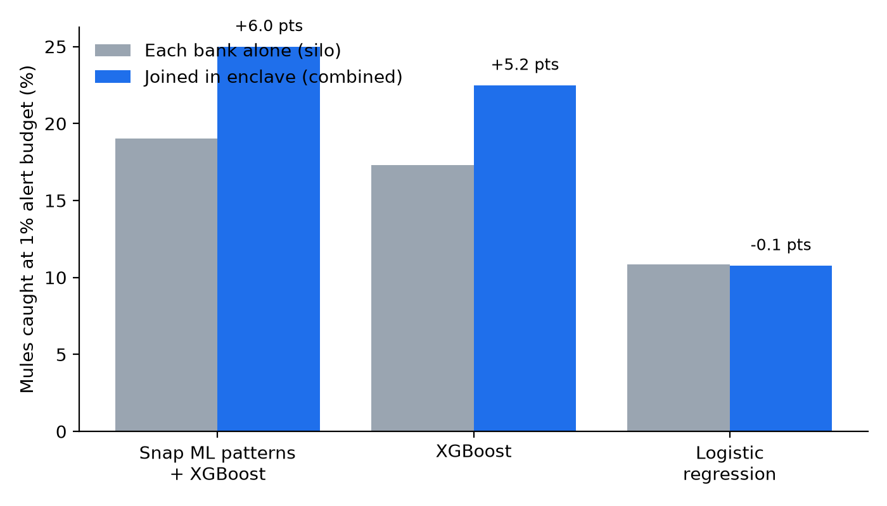

# MuleNet-Z

**Cross-bank money-mule detection without any bank sharing its data.** IBM Z Datathon 2026 · Theme: *AI Secured: Innovation Without Exposure*

Team: Arindam Gogoi · Niyati Joshi · Vishwajeet Sonawane · Vipul Gujar

## The problem

Scam money hops through mule accounts at several banks within minutes. Each bank sees only its own hop, which looks normal, so the chain stays invisible. Banks cannot pool customer transactions (data-protection law, banking secrecy), and federated learning shares model weights, not the cross-bank transfers where the mule pattern lives.

## Our approach

1. Each bank pseudonymises account IDs (shared HMAC key) and encrypts its transactions with its own AES-256-GCM key.
2. A confidential-computing enclave on IBM Z receives the keys only after attestation, joins the slices into one transaction graph, and mines it with **IBM Snap ML's Graph Feature Preprocessor** (fan-in, fan-out, scatter-gather, temporal cycles).
3. An XGBoost model scores every account on these patterns plus account features.
4. Each bank receives an encrypted alert file containing **only its own accounts**, with evidence.

> **Prototype note:** the enclave boundary is *simulated* in software (encryption + a simulated attestation check). The production target is IBM Secure Execution for Linux / Hyper Protect, with keys in Crypto Express HSMs.

## Results (full data)

IBM AML dataset HI-Small: 5,078,345 transactions, 515,088 accounts, split into 5 consortium members by real bank ID. Each model is trained twice, once per bank on its own data only and once on the joined graph, then evaluated on the same test accounts. Each bank alerts on its top 1% of test accounts.

| Model | Recall, each bank alone | Recall, joined | Uplift (95% CI) | Cross-bank chains caught (of 662) |
|---|---|---|---|---|
| **Snap ML graph patterns + XGBoost** | 19.0% | **25.0%** | **+6.0 pts (+3.9 to +8.0)** | 160 → 193 |
| XGBoost, account features only | 17.3% | 22.5% | +5.2 pts (+3.2 to +7.2) | 154 → 187 |
| Logistic regression | 10.8% | 10.8% | −0.1 pts (−0.9 to +0.8) | 115 → 115 |

- **32% more mules caught at the same alert budget**, and PR-AUC rises from 0.168 to 0.261.
- **Every bank gains:** B1 +6.0, B2 +3.9, B3 +6.6, B4 +6.5, B5 +6.8 pts (`results/metrics_per_bank.csv`).
- **Ablation:** with the joined graph but each bank using only its own labels, there is no gain (−1.1 pts, CI −2.9 to +0.7). The value comes from pooling known-mule intelligence together with the joined graph, which is exactly what the enclave makes safe.
- **Robustness on a second dataset (IBM AML LI-Small:** 6.9M transactions, a rarer laundering signal with 0.75% mules**):** the same pipeline lifts recall from 9.3% to 12.4% (**+3.1 pts, 95% CI +0.9 to +5.2**), again about a third more mules caught at the same alert budget. PR-AUC more than doubles (0.035 → 0.081), and cross-bank chains caught rise from 81 to 94 of 580. Four of five banks gain; the smallest bank (B1, 137 test mules) is flat (−0.8 pts). The own-labels ablation again shows no gain (−1.0 pts). See `results/metrics_li.csv`.
- **Versus federated learning** (decision rule fixed in advance: non-overlapping recall CIs). A federated-learning proxy (one model on all banks' labels, each account's features from its own bank's view only) reaches 22.6% on HI-Small and 12.2% on LI-Small. By our pre-set rule the joined graph **matches FL** on both datasets. The paired comparison shows the joined graph adds +2.4 pts on HI-Small (95% CI +0.5 to +4.2) and +0.3 pts on LI-Small (−1.4 to +2.1). Most of the gain comes from pooling labels; the joined graph adds to it on HI-Small only. See `results/fl_proxy_hi.csv` and `fl_proxy_li.csv`.
- Graph-pattern features are **causal**: each transaction only sees earlier transactions, as in live scoring.
- The whole full-data experiment ran on an IBM LinuxONE Community Cloud server (s390x, 3 vCPU, 8 GB RAM) in 27 minutes, by streaming transactions to Snap ML.



## Repository layout

| Path | What |
|---|---|
| `mulenet/build.py` | Raw IBM AML CSV → `nodes.csv` + `edges.npz` (bank → member mapping, labels, 60/20/20 split) |
| `mulenet/common.py` | Shared loader: `load_view("combined" or "B1".."B5")`, per-view account features, laundering chains |
| `mulenet/gfp.py` | Snap ML graph-pattern features (one-shot and streaming) + XGBoost runs |
| `mulenet/baselines.py` | Logistic regression and XGBoost baselines |
| `mulenet/gnn.py` | Direction-aware GraphSAGE / SIGN baselines (PyTorch) |
| `mulenet/evaluate.py` | Official evaluator: recall at budget, paired bootstrap CI, chain detection |
| `mulenet/enclave.py` | Enclave simulation: keyring, bank submission, attestation, per-bank encrypted alerts, isolation check |
| `run_full_gfp_stream.py` | Full-data Snap ML + XGBoost run (silo, combined, own-labels ablation) |
| `final_results.py` | Builds `results/metrics.csv`, the per-bank table and the figure |
| `notebooks/` | Per-role notebooks (data, model, evaluation, enclave demo) |

## Reproduce

```bash
# 1. data (Kaggle: ealtman2019/ibm-transactions-for-anti-money-laundering-aml) → data/HI-Small_Trans.csv
python -c "from mulenet.build import build_processed; build_processed(sample_days=None)"
# 2. baselines
python -c "from mulenet.baselines import run_baseline as r; [r(k, s, sample=False, out_dir='results/scores') for k in ('lr','xgb') for s in ('silo','combined')]"
# 3. Snap ML graph patterns + XGBoost (≈30 min on 3 vCPU / 8 GB)
python run_full_gfp_stream.py
# 4. results table + figure
python final_results.py
```

Requirements: Python 3.11+, numpy, pandas, scikit-learn, xgboost, snapml, torch, torch_geometric, cryptography. Paths in the run scripts assume the LinuxONE Jupyter container (`/home/ibm-user/shared`); change them to your checkout.

## Open-source used

IBM AML dataset · IBM Snap ML · XGBoost · scikit-learn · PyTorch · PyTorch Geometric · pandas · NumPy · cryptography · LinuxONE Community Cloud Jupyter image.

No real customer data is used. Keys live in `secrets/`, which is never committed.
